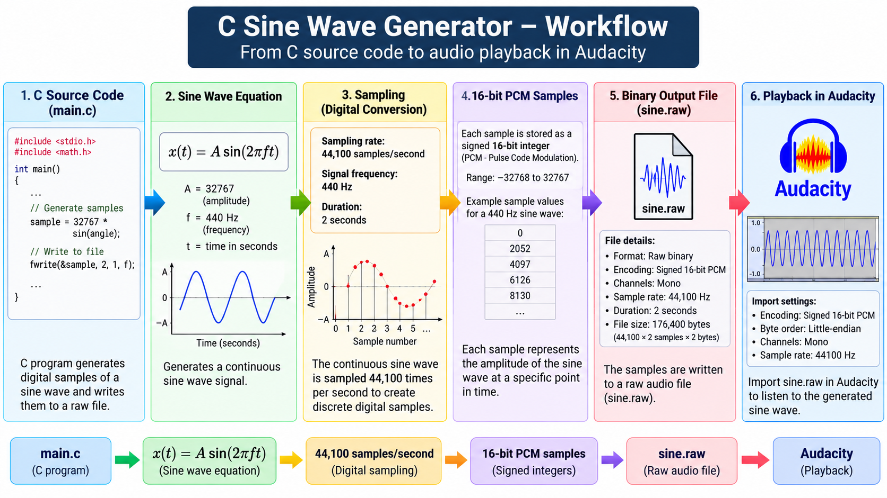

# C Sine Wave Generator



A C programming project that generates a 440 Hz sine wave and writes the digital audio samples to a raw binary file.

## Project Specifications

- Language: C
- Sampling rate: 44,100 samples per second
- Signal frequency: 440 Hz
- Duration: 2 seconds
- Sample format: Signed 16-bit PCM
- Output file: `sine.raw`

## Signal Equation

x(t) = A sin(2πft)

Where:
- A = 32767 (amplitude)
- f = 440 Hz (frequency)
- t = time in seconds

## Compile

```bash
gcc main.c -o main -lm
```

## Run

```bash
./main
```

The program creates `sine.raw` in the current working directory.

## Playback in Audacity

Import `sine.raw` using File → Import → Raw Data.

Use these settings:
- Encoding: Signed 16-bit PCM
- Byte order: Little-endian
- Channels: Mono
- Sample rate: 44100 Hz

## Version History

### v1.0.0
- Generate a 440 Hz sine wave.
- Produce two seconds of samples.
- Save the generated samples to a raw audio file.
- Verify playback in Audacity.